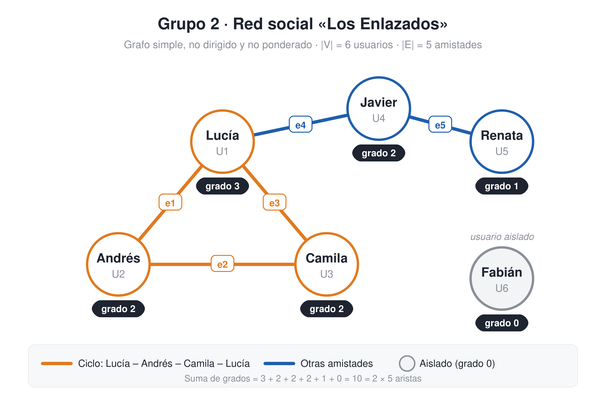
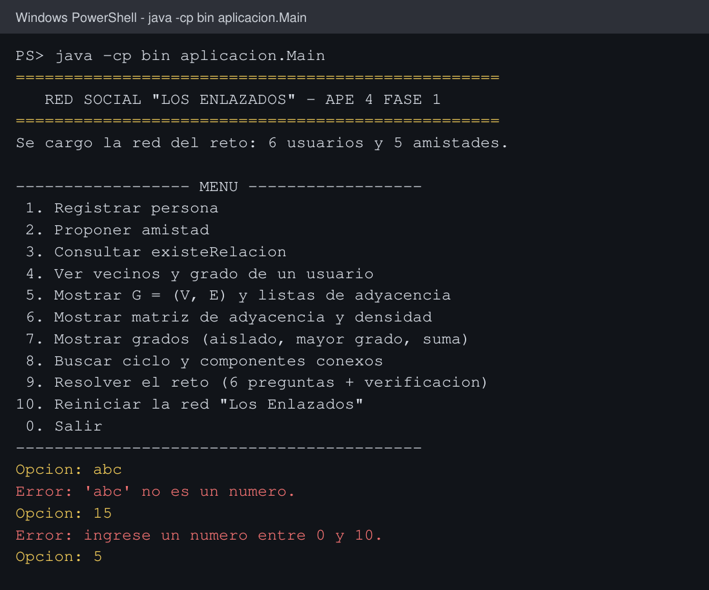
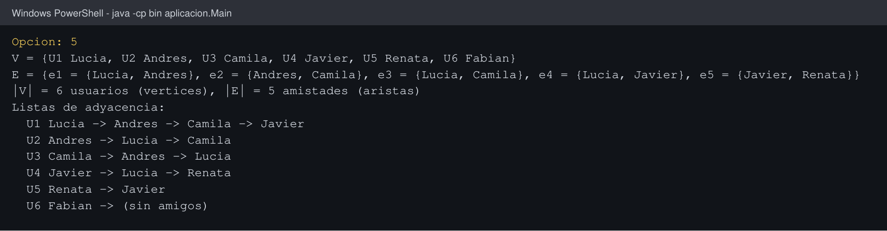
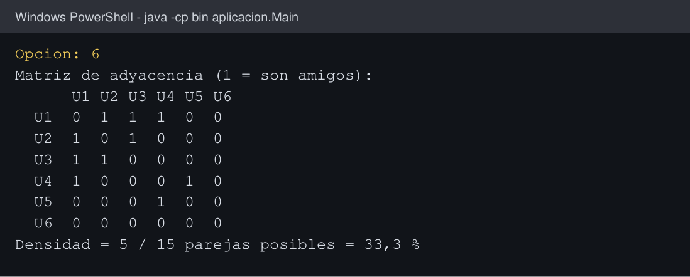
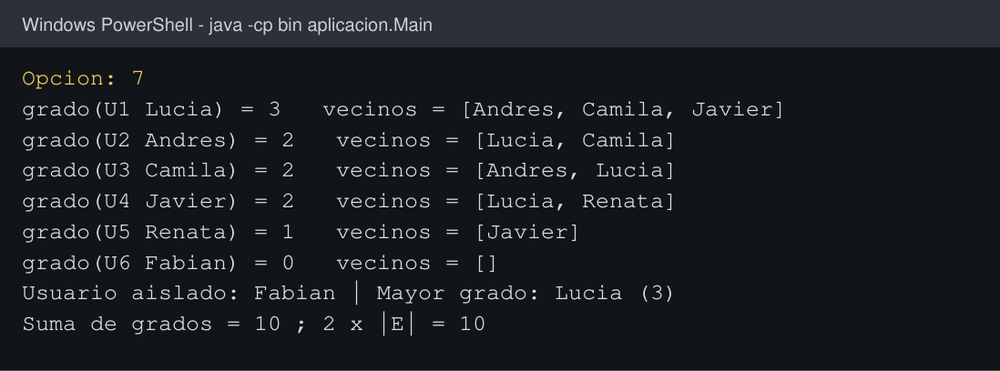
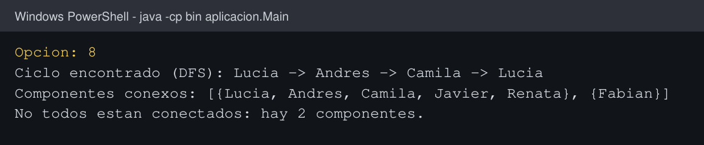
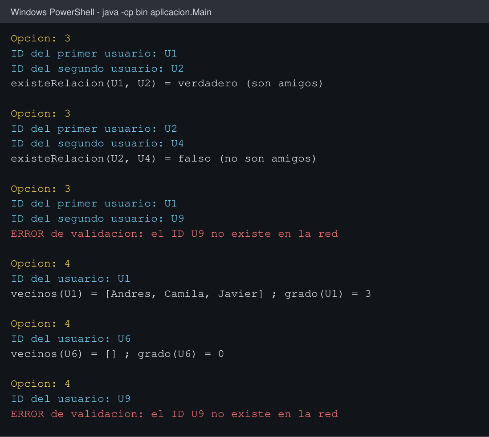
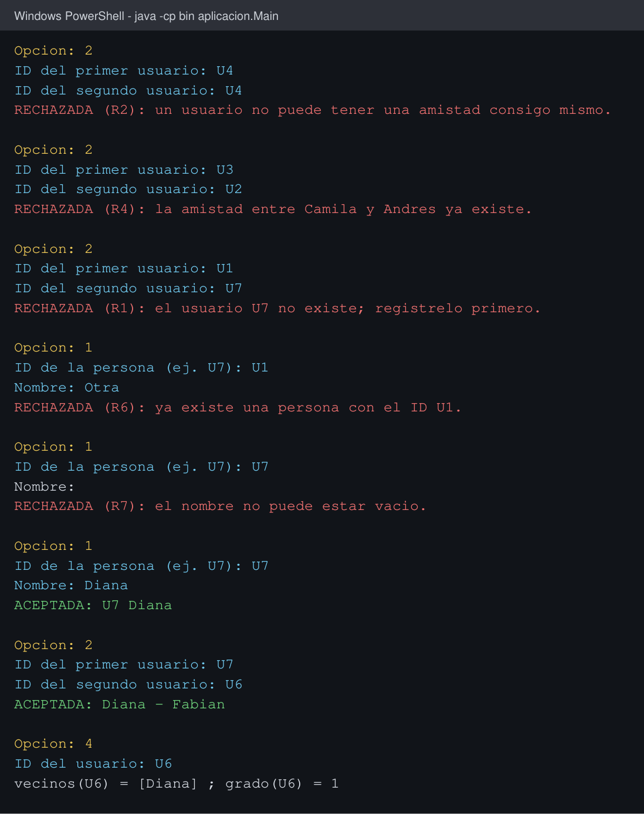
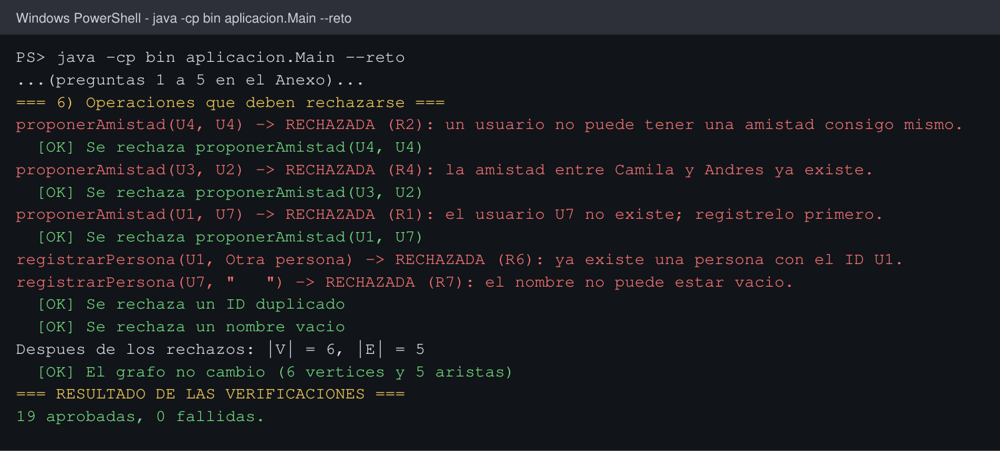

# APE 4 · Fase 1 — Reto de grafos y vértices

**Red social «Los Enlazados» implementada en Java**

Universidad Técnica de Ambato · Facultad de Ingeniería en Sistemas, Electrónica e Industrial
Carrera de Software · Estructura de Datos · Tercero B · Ing. José Caiza, Mg.

**Autor:** Cunalata Mendoza Damian Alexander (`Damienq7w`)

---

## Contenido

1. [Objetivo](#objetivo)
2. [La red social](#la-red-social)
3. [Requisitos del reto](#requisitos-del-reto)
4. [Cómo compilar y ejecutar](#cómo-compilar-y-ejecutar)
5. [Menú del programa](#menú-del-programa)
6. [Diseño de la solución](#diseño-de-la-solución)
7. [Capturas de funcionamiento y respuestas a las 6 preguntas](#capturas-de-funcionamiento-y-respuestas-a-las-6-preguntas)
8. [Validaciones (reglas R1–R7)](#validaciones-reglas-r1r7)
9. [Verificación automática](#verificación-automática)
10. [Estructura del repositorio](#estructura-del-repositorio)
11. [Referencias](#referencias)

---

## Objetivo

Diseñar una red social original de **6 usuarios y 5 amistades**, modelada como un grafo **simple, no dirigido y no ponderado** con al menos un ciclo, un usuario aislado y un usuario de grado 3 o mayor. Después, implementarla en Java para responder con razonamiento las seis preguntas guía del reto.

El reto se publicó en el Padlet *«APE 4 · Fase 1 | Reto de grafos y vértices por grupos»*. El programa usa las operaciones y reglas del modelo de referencia que expuso el **Grupo 4** ([APE4-Fase-1-Grupo4](https://github.com/shirleymikaela2/APE4-Fase-1-Grupo4)): `registrarPersona`, `proponerAmistad`, `existeRelacion`, `vecinos` y `grado`.

## La red social



**G = (V, E)**

- **V** = {U1 Lucía, U2 Andrés, U3 Camila, U4 Javier, U5 Renata, U6 Fabián}
- **E** = {e1 = {Lucía, Andrés}, e2 = {Andrés, Camila}, e3 = {Lucía, Camila}, e4 = {Lucía, Javier}, e5 = {Javier, Renata}}

> En el programa los nombres van sin tildes (Lucia, Andres, Fabian), para que la consola de Windows los muestre bien.

## Requisitos del reto

| Condición | Cómo se cumple | Verificado en el programa |
|---|---|:---:|
| Exactamente 6 vértices | U1 a U6 | ✅ |
| Exactamente 5 aristas, contadas una vez | e1 a e5 | ✅ |
| Simple: sin lazos ni duplicados | Diagonal de la matriz en 0 y listas sin repetidos | ✅ |
| No dirigido | La amistad se guarda en ambos sentidos; la matriz es simétrica | ✅ |
| No ponderado | Las aristas no guardan peso | ✅ |
| Al menos un ciclo de 3 o más vértices | Lucía → Andrés → Camila → Lucía | ✅ |
| Al menos un usuario aislado | Fabián (grado 0) | ✅ |
| Al menos un usuario con grado ≥ 3 | Lucía (grado 3) | ✅ |
| Suma de grados = 2 × aristas | 3 + 2 + 2 + 2 + 1 + 0 = 10 = 2 × 5 | ✅ |

## Cómo compilar y ejecutar

Requiere **JDK 17 o superior**; se probó con JDK 21. Los comandos se ejecutan desde la raíz del repositorio, en PowerShell o CMD.

```powershell
javac -d bin src/modelo/*.java src/estructuras/*.java src/aplicacion/*.java
```

Para abrir el **menú interactivo**:

```powershell
java -cp bin aplicacion.Main
```

Para **resolver el reto completo**, con las 6 preguntas y las 19 verificaciones automáticas:

```powershell
java -cp bin aplicacion.Main --reto
```

## Menú del programa

El `main` (clase `aplicacion.Main`) presenta un menú y atiende cada opción con un `switch`. Las entradas se validan: si se escriben letras o números fuera de rango, el programa vuelve a pedir el dato y no se cierra.

| Opción | Acción | Operación usada |
|:---:|---|---|
| 1 | Registrar persona | `registrarPersona(id, nombre)` |
| 2 | Proponer amistad | `proponerAmistad(idA, idB)` |
| 3 | Consultar si dos usuarios son amigos | `existeRelacion(idA, idB)` |
| 4 | Ver vecinos y grado de un usuario | `vecinos(id)`, `grado(id)` |
| 5 | Mostrar G = (V, E) y listas de adyacencia | `mostrarVE()`, `mostrarListas()` |
| 6 | Mostrar matriz de adyacencia y densidad | `matrizAdyacencia()`, `densidad()` |
| 7 | Mostrar grados, aislado y mayor grado | `mostrarGrados()` |
| 8 | Buscar ciclo y componentes conexos | `buscarCiclo()`, `componentes()` |
| 9 | Resolver el reto (6 preguntas + verificación) | `reto()` |
| 10 | Reiniciar la red «Los Enlazados» | `losEnlazados()` |
| 0 | Salir | — |

## Diseño de la solución

El código está organizado en **3 paquetes**, separados por responsabilidad:

| Paquete | Clase | Responsabilidad |
|---|---|---|
| `modelo` | [`Persona`](src/modelo/Persona.java) | Vértice: ID, nombre, inicio de **su** lista de amigos y la siguiente persona de la lista de vértices. |
| `modelo` | [`NodoAmistad`](src/modelo/NodoAmistad.java) | Nodo de una lista de adyacencia: apunta al vértice del amigo, no a una copia de su nombre. |
| `estructuras` | [`RedSocialGrafo`](src/estructuras/RedSocialGrafo.java) | El grafo: lista enlazada de personas, operaciones (R1–R7), análisis (ciclo, componentes, matriz, densidad) y salida de cada consulta. |
| `aplicacion` | [`Main`](src/aplicacion/Main.java) | Menú con `switch`, lectura validada de entradas y resolución del reto (`--reto`). |

El grafo no conoce el menú, y `Main` solo usa las operaciones públicas del grafo.

```
Lista de vértices                 Listas de adyacencia
[U1 Lucia]  ───────────────────▶  Andres → Camila → Javier
   │
[U2 Andres] ───────────────────▶  Lucia → Camila
   │
   ...
[U6 Fabian] ───────────────────▶  (vacía)
```

**Decisiones de diseño:**

- **Lista de adyacencia con nodos propios.** La red es dispersa (5 amistades de 15 posibles), así que solo se guardan las amistades que existen. No se usan `HashMap`, `HashSet`, `TreeMap` ni `TreeSet`.
- **No dirigido (R3).** `proponerAmistad` agrega la amistad en la lista de A y en la de B, pero la cuenta una sola vez.
- **Un ID inexistente es un error.** Las consultas lanzan un error de validación, que no se confunde con un usuario aislado: este existe y tiene grado 0.
- **DFS** sirve para dos cosas: detectar el ciclo, reconstruyéndolo a partir de la arista que vuelve a un vértice ya visitado, y encontrar los componentes conexos.
- **Matriz de adyacencia.** Se genera a partir de las listas, solo para comprobar el modelo: debe ser simétrica y tener la diagonal en 0, como propuso el Grupo 4.

| Operación | Complejidad |
|---|---|
| `registrarPersona` | O(V) |
| `proponerAmistad` | O(V + g) |
| `existeRelacion` | O(V + g) |
| `vecinos` / `grado` | O(V + g) |
| `buscarCiclo` / `componentes` (DFS) | O(V · (V + E)) por el cálculo del índice; O(V + E) con índices precalculados |

*V = usuarios, E = amistades, g = grado del usuario consultado.*

## Capturas de funcionamiento y respuestas a las 6 preguntas

Las capturas son imágenes generadas a partir de la salida real del programa, sin modificar el texto. La sesión del menú se ejecutó con las entradas de [`evidencias/entrada_prueba_menu.txt`](evidencias/entrada_prueba_menu.txt), y su salida completa está en [`evidencias/salida_menu.txt`](evidencias/salida_menu.txt).

### Menú y validación de entradas



Si se escribe `abc` o `15`, el programa avisa del error y vuelve a pedir la opción.

### Pregunta 1 · G = (V, E)



Cada vértice es un usuario y cada arista una amistad. Las aristas se escriben como conjuntos {u, v} porque el orden no importa: |V| = 6 y |E| = 5.

### Pregunta 2 · Simple, no dirigido y no ponderado



- **Simple:** la diagonal está en 0, así que no hay lazos, y cada pareja aparece una sola vez.
- **No dirigido:** la matriz es simétrica, porque la amistad es mutua.
- **No ponderado:** solo hay 0 y 1. Una amistad existe o no existe, sin peso.
- **Densidad:** 5 / 15 = 33,3 %.

### Pregunta 3 · Grados



- **Fabián** es el usuario aislado (grado 0).
- **Lucía** es la de mayor grado (3).
- **La suma de los grados es 10 = 2 × 5**, porque cada amistad suma uno al grado de sus dos extremos.

### Pregunta 4 · Ciclo y conexión



El DFS encuentra el ciclo **Lucía → Andrés → Camila → Lucía**. Hay **2 componentes**: {Lucía, Andrés, Camila, Javier, Renata} y {Fabián}. Por eso no todos los usuarios están conectados: Fabián no tiene ningún camino hacia los demás.

### Pregunta 5 · existeRelacion, vecinos y grado



- `existeRelacion(U1, U2)` da **verdadero**: Lucía y Andrés son amigos.
- `existeRelacion(U2, U4)` da **falso**: Andrés y Javier no son amigos, aunque los dos lo son de Lucía.
- `vecinos(U1)` = {Andrés, Camila, Javier} y `grado(U1)` = 3.
- `vecinos(U6)` = {} y `grado(U6)` = 0: Fabián existe, pero está aislado.
- `U9` no existe: da un **error de validación**.

### Pregunta 6 · Operaciones que deben rechazarse



Los intentos inválidos se rechazan con la regla que incumplen y el grafo no cambia. Al final de la captura se registra un usuario nuevo válido (U7 Diana) y su amistad con Fabián, para mostrar que las operaciones correctas sí se aceptan.

### Reto completo y verificaciones (opción 9 o `--reto`)



## Validaciones (reglas R1–R7)

| Regla | Qué impide | Ejemplo | Mensaje del sistema |
|---|---|---|---|
| R1 | Amistad con un usuario inexistente | `proponerAmistad(U1, U7)` | `RECHAZADA (R1): el usuario U7 no existe; registrelo primero.` |
| R2 | Lazo: amistad consigo mismo | `proponerAmistad(U4, U4)` | `RECHAZADA (R2): un usuario no puede tener una amistad consigo mismo.` |
| R3 | Amistad en un solo sentido | (automática) | La amistad se guarda en las dos listas |
| R4 | Amistad duplicada, en cualquier orden | `proponerAmistad(U3, U2)` | `RECHAZADA (R4): la amistad entre Camila y Andres ya existe.` |
| R6 | ID duplicado | `registrarPersona(U1, "Otra")` | `RECHAZADA (R6): ya existe una persona con el ID U1.` |
| R7 | Nombre vacío | `registrarPersona(U7, "   ")` | `RECHAZADA (R7): el nombre no puede estar vacio.` |
| — | ID inexistente en una consulta | `vecinos(U9)` | `ERROR de validacion: el ID U9 no existe en la red` |

## Verificación automática

`java -cp bin aplicacion.Main --reto` ejecuta **19 comprobaciones** sobre una red nueva y termina con código 1 si alguna falla. Cubren:

- los conteos (6 vértices y 5 aristas);
- las propiedades de grafo simple y no dirigido;
- el ciclo, el usuario aislado y el grado ≥ 3;
- la suma de grados = 2 × |E|;
- la reciprocidad;
- el error por un ID inexistente;
- los cinco rechazos, comprobando que el grafo no cambia.

**Resultado: 19 aprobadas, 0 fallidas.** La salida completa está en [`evidencias/salida_reto.txt`](evidencias/salida_reto.txt).

## Estructura del repositorio

```
src/modelo/Persona.java              Vértice (nodo propio)
src/modelo/NodoAmistad.java          Nodo de la lista de adyacencia
src/estructuras/RedSocialGrafo.java  Grafo, operaciones y análisis
src/aplicacion/Main.java             Menú con switch y reto (--reto)
evidencias/grafo_red_social.png      Diagrama del grafo
evidencias/capturas/                 Capturas de funcionamiento (8)
evidencias/entrada_prueba_menu.txt   Entradas usadas en la sesión del menú
evidencias/salida_menu.txt           Salida real de esa sesión
evidencias/salida_reto.txt           Salida real de --reto
README.md
```

## Referencias

1. Grupo 4, «APE 4 · Fase 1 | Reto de grafos y vértices por grupos», Padlet, 2026.
2. Grupo 4, [APE4-Fase-1-Grupo4: modelo de referencia de una red social](https://github.com/shirleymikaela2/APE4-Fase-1-Grupo4), GitHub, 2026.
3. T. H. Cormen, C. E. Leiserson, R. L. Rivest y C. Stein, *Introduction to Algorithms*, 4.ª ed. MIT Press, 2022.
4. M. A. Weiss, *Data Structures and Algorithm Analysis in Java*, 3.ª ed. Pearson, 2012.
